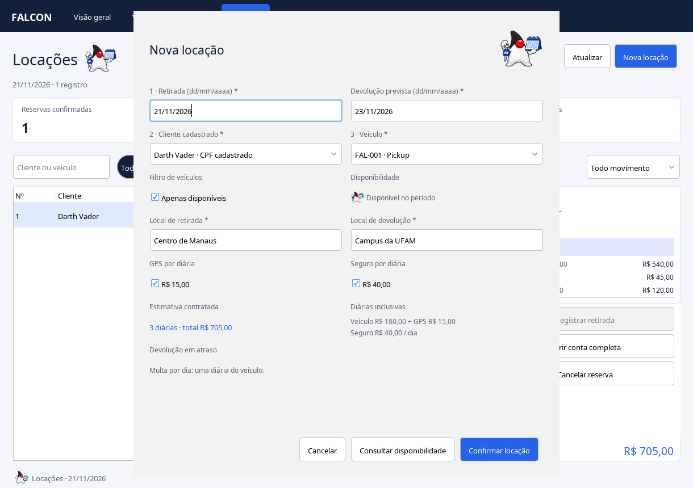
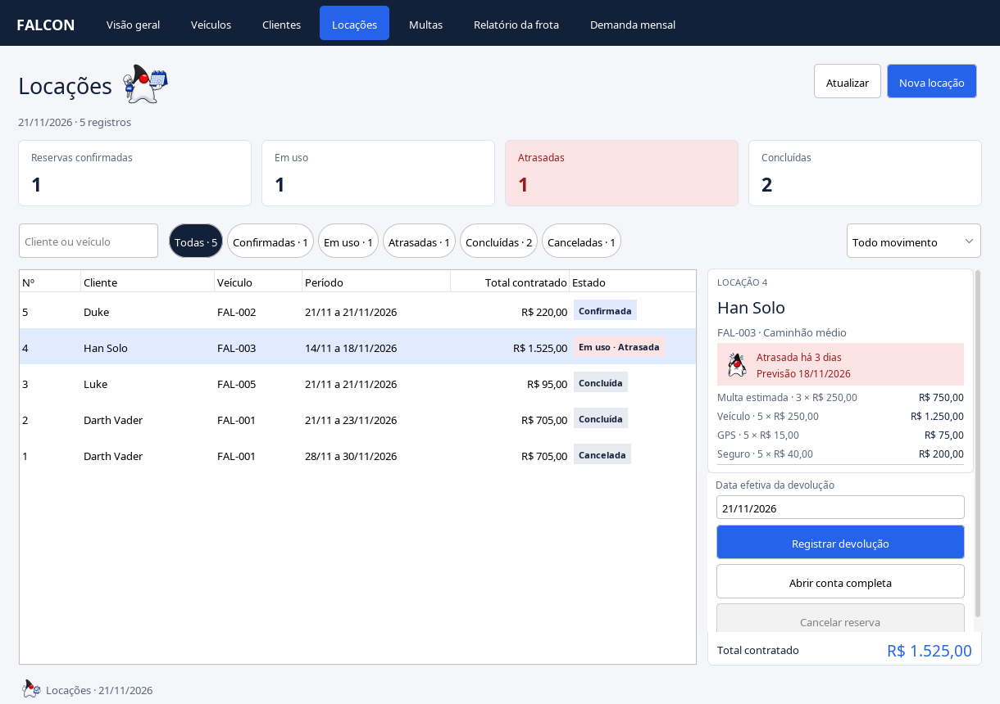
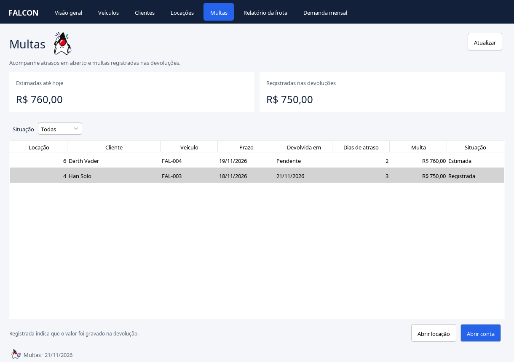

# Falcon Locadora

Aplicação desktop em Java para administrar uma locadora de veículos de frete. Cadastre clientes e veículos, consulte a disponibilidade, confirme reservas e acompanhe retiradas, devoluções e multas. Os relatórios mostram a frota e a demanda por categoria. O projeto foi desenvolvido como trabalho prático da disciplina de Programação Orientada a Objetos.

## Rodar a demonstração com H2

Você precisa de Git, um **JDK 17 ou superior** e uma sessão gráfica. Confira `java -version` e `javac -version` e configure `JAVA_HOME` para apontar para o JDK completo. O Maven Wrapper baixa o Maven e as dependências na primeira execução.

```sh
git clone https://github.com/JulioCesar-cmd/falcon-locadora.git
cd falcon-locadora
```

**Linux**

```sh
./executar.sh --demo
```

**Windows (PowerShell)**

```powershell
.\executar.bat --demo
```

A demonstração abre com clientes, veículos e locações fictícios em um banco H2 em memória. A data de atendimento é **21/11/2026** e os dados retornam ao estado inicial a cada abertura. Para gravar seus próprios cadastros em um H2 local, inicie sem `--demo` e escolha **Banco local** no primeiro acesso. O banco local é criado em `dados/falcon.mv.db`.

## Roteiro de demonstração

1. Em **Locações**, selecione a reserva de exemplo **#5**, de **Duke** para a van **FAL-002**. Clique em **Cancelar reserva**, informe um motivo fictício e confirme. Isso libera a van para a reserva que você vai criar.
2. Clique em **Nova locação**. Selecione **Duke** e **FAL-002**, informe **21/11/2026** para retirada e devolução, preencha os dois locais e deixe GPS e seguro desmarcados. Depois de consultar a disponibilidade, clique em **Confirmar locação**. O valor contratado é **R$ 220,00**.
3. Feche o resumo da reserva, selecione a nova locação e clique em **Registrar retirada**. Confirme para mudar a locação para **Em uso**.
4. Para simular o atraso com a data fixa da demonstração, selecione a locação **#6**, que já está em uso com devolução prevista para **19/11/2026**. Mantenha **21/11/2026** como data efetiva, clique em **Registrar devolução** e confirme a multa de **R$ 760,00** (dois dias × R$ 380,00). Em **Multas**, confira a situação **Registrada** dessa locação.

A multa usa a diária do veículo gravada na reserva, por dia corrido de atraso. Os valores contratados de GPS e seguro são mantidos.

### Capturas da interface

| Nova locação | Acompanhamento da locação | Painel de multas |
| --- | --- | --- |
|  |  |  |

## Estrutura e testes

- `ui` contém as telas Swing com FlatLaf, os formulários e os painéis de locações e multas.
- `service` concentra as regras de disponibilidade, reserva e transição de estados.
- `model` representa clientes, veículos e contratos. `dao` gerencia a persistência JDBC e as migrações do esquema.
- `src/main/resources` contém as imagens da interface e os dados fictícios. `src/test` cobre locações, multas, concorrência e migração.

Para executar os testes e gerar o JAR no Linux:

```sh
./mvnw --batch-mode verify
```

Para gerar o Javadoc, execute `./mvnw javadoc:javadoc` no Linux ou `.\mvnw.cmd javadoc:javadoc` no Windows. Abra `target/reports/apidocs/index.html`.

## MariaDB opcional

Para usar um servidor MariaDB, prepare o banco e o usuário com [sql/preparar-banco.sql](sql/preparar-banco.sql), substituindo a senha de exemplo. Copie `config.example.properties` para `config.properties`, preencha a URL JDBC e as credenciais locais e execute o script de inicialização sem `--demo`. O arquivo `config.properties` é ignorado pelo Git.

Se estiver reaproveitando a base de uma versão anterior da Falcon, consulte o [guia de migração](ATUALIZACAO_FASE_2.md).
